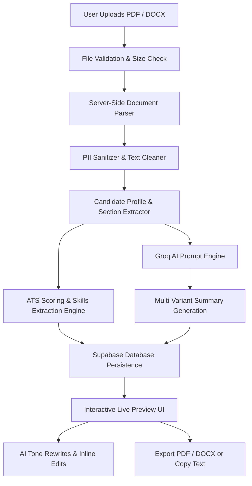

# Resumly

> AI-Powered Resume Analysis & Recruiter-Ready Summary Generator. Understand and optimize your resume in seconds.

[](https://resumly-eta.vercel.app/)
[](https://nextjs.org/)
[](https://react.dev/)
[](https://www.typescriptlang.org/)
[](https://tailwindcss.com/)
[](https://groq.com/)
[](https://supabase.com/)

---

### 🚀 Live Demo: **[Open Resumly](https://resumly-eta.vercel.app/)**

Experience the live application hosted on Vercel: **[https://resumly-eta.vercel.app/](https://resumly-eta.vercel.app/)**

---

## 📖 Overview

**Resumly** is a modern, AI-first web application designed to help job seekers instantly evaluate, optimize, and elevate their resumes. Instead of generic templates or tedious resume builders, Resumly focuses on the highest-leverage section of any job application: **the professional summary and candidate positioning**.

Recruiters spend an average of 6 seconds reviewing a resume. Resumly extracts key career milestones, skills, and metrics from uploaded resumes (PDF & DOCX), calculates an **ATS Readiness Score (0–100)**, extracts core technical competencies, and synthesizes 3 targeted, recruiter-ready summaries tailored to different hiring contexts.

### Why Resumly?
- **Speed**: Generates recruiter-grade summaries and ATS insights in under 10 seconds via Groq LPU inference.
- **Context-Aware Summaries**: Produces distinct Professional, ATS-Optimized, and Executive variations.
- **Data Privacy First**: Automatically redacts sensitive personal contact information (emails, phone numbers, addresses) prior to LLM processing.
- **Interactive Customization**: Allows one-click AI tone rewrites (Confident, Technical, Action-Oriented, Creative) and inline manual editing.
- **Export Ready**: Exports polished summary sheets directly into PDF or Microsoft Word (`.docx`) with a single click.

---

## ✨ Features

### 📄 Multi-Format Resume Ingestion
- **PDF & DOCX Parsing**: Fast server-side document parsing using `pdf-parse` and `mammoth`.
- **Drag-and-Drop Uploader**: Fluid, responsive upload interface with real-time file size & extension validation (up to 10 MB).
- **PII Sanitization**: Automatic redaction of phone numbers, physical addresses, and email addresses to protect candidate privacy.

### 🤖 Multi-Variant AI Summary Generation
Resumly crafts three distinct professional summary styles from the extracted candidate profile:
1. **💼 Professional Summary**: A polished, recruiter-ready narrative (2–4 sentences) balancing career trajectory, core strengths, and business impact.
2. **🎯 ATS-Optimized Summary**: High keyword-density summary formatted to maximize match rates in Applicant Tracking Systems.
3. **⚡ Executive Summary**: Concise, high-level strategic pitch emphasizing leadership, operational scale, and ROI.

### 🎭 AI Tone Rewriter & Inline Editor
- **Dynamic Tone Shifting**: Instantly rewrite any summary variation into:
  - **Confident**: Authoritative, assertive, and leadership-focused.
  - **Technical**: Stack-dense, emphasizing methodologies and engineering rigor.
  - **Action-Oriented**: Results-first phrasing driven by high-impact action verbs.
  - **Creative**: Expressive, dynamic, highlighting innovation and problem-solving.
- **Direct Manual Editing**: Edit summary text directly inside the browser with immediate auto-save and database persistence.
- **One-Click Copy**: Copy any generated summary directly to your clipboard.

### 📊 ATS Readiness Scoring & Candidate Insights
- **Score Meter (0–100)**: Instant evaluation across structural formatting, experience quantification, and keyword strength.
- **Score Breakdown & Deductions**: Actionable feedback detailing what was penalized and how to fix it.
- **Skill Extraction**: Automatic identification and tagging of core competencies and frameworks.
- **Metadata Detection**: Extracted job title, detected years of experience, industry classification, word count, and reading time estimate.

### 📥 Document Exporters
- **PDF Summary Sheet**: Client-side, publication-grade candidate profile PDF generated using `jspdf`.
- **Word Document (`.docx`)**: Clean OpenXML document generated via `docx` formatted with typography, skill tags, and optimization tips.

### 🔐 Authentication & Session History
- **Anonymous Guest Quota**: Try up to 3 summaries without signing in, tracked via secure anonymous session cookies.
- **Supabase Authentication**: Email/password authentication and account management.
- **Automatic History Claiming**: Log in or create an account to instantly migrate all anonymous guest summaries into your permanent account history.
- **History Sidebar**: Browse, search, and reload previously analyzed resumes and their summaries.

### 🎨 Design & Experience
- **Editorial Typography**: Pairing **Outfit** (headings), **DM Sans** (body & UI), and **JetBrains Mono** (metrics & scores).
- **Dark & Light Mode**: Built-in system theme detection and manual toggle via `next-themes`.
- **Micro-Interactions**: Smooth entrance and layout transitions powered by `framer-motion`.

---

## 🛠️ Tech Stack

### **Frontend**
| Technology | Description |
| :--- | :--- |
| **[Next.js 16](https://nextjs.org/)** | App Router framework, React Server Components & API route handlers |
| **[React 19](https://react.dev/)** | Latest React features and compiler optimizations |
| **[TypeScript 5](https://www.typescriptlang.org/)** | Strict type safety across client and server |
| **[Tailwind CSS v4](https://tailwindcss.com/)** | Modern styling engine with OKLCH theme tokens and CSS variables |
| **[Framer Motion](https://www.framer.com/motion/)** | Fluid animations, layout transitions, and interactive UI states |
| **[Zustand 5](https://github.com/pmndrs/zustand)** | Lightweight client state management for active session & resume store |
| **[Lucide React](https://lucide.dev/)** | Consistent, modern icon system |
| **[next-themes](https://github.com/pacocoursey/next-themes)** | Seamless dark/light theme switching |

### **Backend & APIs**
| Technology | Description |
| :--- | :--- |
| **Next.js Route Handlers** | Serverless API routes for parsing, AI generation, and database operations |
| **[Groq SDK](https://groq.com/)** | Ultra-low latency LLM inference using models such as `openai/gpt-oss-120b` |
| **[OpenAI SDK](https://github.com/openai/openai-node)** | Abstracted provider interface for LLM completions |
| **[pdf-parse](https://www.npmjs.com/package/pdf-parse)** | Server-side PDF binary parsing and text extraction |
| **[Mammoth](https://www.npmjs.com/package/mammoth)** | DOCX to plain text and structural extraction |

### **Database & Auth**
| Technology | Description |
| :--- | :--- |
| **[Supabase](https://supabase.com/)** | Managed PostgreSQL database storing resume summaries and metadata |
| **Supabase Auth** | JWT-based user authentication and session management |
| **Row Level Security (RLS)** | Database-level authorization rules protecting user history |

### **Export & Document Generation**
| Technology | Description |
| :--- | :--- |
| **[jsPDF](https://github.com/parallax/jsPDF)** | Dynamic client-side PDF document generation |
| **[docx](https://docx.js.org/)** | Dynamic client-side OpenXML `.docx` Word document generator |

---

## 🏗️ How Resumly Works



1. **Upload & Parse**: The user uploads a resume file (`.pdf` or `.docx`). The server validates the format and size (< 10 MB) and extracts raw text using `pdf-parse` or `mammoth`.
2. **Sanitization**: Contact information such as phone numbers, emails, and street addresses are sanitized and redacted before LLM processing.
3. **Extraction & Scoring**: The engine scans work experience, career milestones, and skill tokens to calculate the ATS Readiness score and detect career metadata (job title, industry, experience level).
4. **AI Generation**: Resumly calls Groq (`openai/gpt-oss-120b`) with specialized system prompts to generate the Professional, ATS, and Executive summary variants.
5. **Interactive UI**: The candidate reviews their summaries, adjusts tone (Confident, Technical, Action-Oriented, Creative), makes manual inline revisions, or exports the summary sheet to PDF or Word.

---

## 📂 Project Structure

```
ecommerce/
├── public/                     # Static assets, SVG icons, and preview media
├── src/
│   ├── app/                    # Next.js App Router structure
│   │   ├── api/                # Backend API route handlers
│   │   │   ├── history/        # History retrieval and session claiming
│   │   │   ├── rewrite/        # AI tone rewrite endpoint
│   │   │   ├── summarize/      # Main resume analysis & usage tracking
│   │   │   └── summary/edit/   # Manual summary update endpoint
│   │   ├── privacy/            # Privacy policy page
│   │   ├── terms/              # Terms of service page
│   │   ├── globals.css         # Global stylesheet & Tailwind CSS variables
│   │   ├── layout.tsx          # Root layout with fonts & theme provider
│   │   └── page.tsx            # Main landing page
│   ├── components/
│   │   ├── common/             # Reusable UI primitives, cards, buttons, theme-provider
│   │   └── layout/             # Navbar, Footer, AuthModal, HistorySidebar
│   ├── features/
│   │   └── landing/            # Landing page feature modules
│   │       ├── components/     # Animated workflow visualizations
│   │       └── sections/       # Hero, UploadSection, LivePreview, HowItWorks
│   ├── lib/
│   │   ├── ai/                 # Parsers, cleaners, validators, and Groq/OpenAI providers
│   │   ├── summarization/      # Scoring logic, prompt builders, profile extractors
│   │   ├── anonymousSession.ts # Guest cookie session utilities
│   │   ├── documentExporter.ts # PDF & DOCX export builders
│   │   ├── quota.ts            # Anonymous and authenticated rate/quota checking
│   │   ├── supabase.ts         # Supabase client and admin initialization
│   │   └── utils.ts            # Class merging and formatting helpers
│   ├── store/
│   │   └── summarization.ts    # Zustand store managing resume state & UI actions
│   └── types/                  # Shared TypeScript schemas and interfaces
├── .env.example                # Template for environment configuration
├── package.json                # Project dependencies and npm scripts
├── tsconfig.json               # TypeScript compiler configuration
└── README.md                   # Project documentation
```

---

## ⚙️ Getting Started

Follow these steps to set up and run Resumly on your local machine.

### Prerequisites
- **Node.js**: `v18.18.0` or higher (Node 20+ recommended)
- **npm** (or `pnpm` / `yarn` / `bun`)
- **Groq API Key**: Obtain a free API key at [console.groq.com](https://console.groq.com/keys)
- **Supabase Project** *(optional for full database features)*: Free project at [supabase.com](https://supabase.com)

### 1. Clone the Repository
```bash
git clone https://github.com/sudhanshuukr/ecommerce.git
cd ecommerce
```

### 2. Install Dependencies
```bash
npm install
```

### 3. Configure Environment Variables
Copy `.env.example` to create `.env.local`:
```bash
cp .env.example .env.local
```

Open `.env.local` and configure the required keys:
```env
# ============================================================
# AI Configuration (Required)
# ============================================================
GROQ_API_KEY="your_groq_api_key_here"
AI_PROVIDER=groq
GROQ_MODEL=openai/gpt-oss-120b

# Maximum file upload size in bytes (default: 10 MB)
MAX_UPLOAD_SIZE=10485760

# Maximum resume text characters sent to AI (default: 25,000)
MAX_RESUME_CHARACTERS=25000

# ============================================================
# Supabase Configuration (Optional for guest mode, Required for Auth/History)
# ============================================================
NEXT_PUBLIC_SUPABASE_URL="https://your-project-id.supabase.co"
NEXT_PUBLIC_SUPABASE_ANON_KEY="your_supabase_anon_key_here"
SUPABASE_SERVICE_ROLE_KEY="your_supabase_service_role_key_here"
```

### 4. Run Local Development Server
```bash
npm run dev
```

Open [http://localhost:3000](http://localhost:3000) in your browser to view Resumly.

### 5. Build for Production
To test the production build locally:
```bash
npm run build
npm run start
```

---

## 🔐 Authentication & Security

- **Anonymous Guest Sandbox**: Guests can analyze up to 3 resumes without an account. Sessions are tracked via signed HTTP-only anonymous session IDs.
- **Seamless Account Claiming**: When an anonymous user signs up or logs in, a secure backend migration endpoint (`/api/history/claim`) links all existing guest summaries to the authenticated user ID.
- **Service Role Isolation**: Administrative database mutations run strictly in server-side Route Handlers via `SUPABASE_SERVICE_ROLE_KEY`, protecting database integrity while exposing standard client operations through scoped RLS policies.
- **PII Scrubbing**: Before resume contents are dispatched to the AI provider, personal phone numbers, email addresses, and physical addresses are scrubbed.

---

## 🗄️ Database & Schema

Resumly uses Supabase PostgreSQL to persist summaries and candidate profiles.

### Primary Table: `summaries`
| Column | Type | Description |
| :--- | :--- | :--- |
| `id` | `UUID` | Primary Key |
| `created_at` | `TIMESTAMPTZ` | Timestamp of creation |
| `user_id` | `UUID` (Nullable) | References Supabase Auth User ID (null for guest sessions) |
| `session_id` | `TEXT` | Anonymous session identifier for guest quota tracking |
| `file_name` | `TEXT` | Original uploaded resume filename |
| `job_title` | `TEXT` | Extracted / inferred candidate job title |
| `professional` | `TEXT` | Generated Professional Summary |
| `ats` | `TEXT` | Generated ATS-Optimized Summary |
| `executive` | `TEXT` | Generated Executive Summary |
| `skills` | `TEXT[]` | Extracted top technical competencies and skills |
| `score` | `INTEGER` | ATS readiness score (0–100) |
| `tips` | `TEXT[]` | Actionable recommendations for resume improvement |
| `word_count` | `INTEGER` | Resume total word count |
| `reading_time` | `TEXT` | Estimated resume reading time |
| `detected_experience`| `TEXT` | Detected years of experience |
| `detected_industry` | `TEXT` | Inferred candidate industry |

---

## 🔌 API Reference

### `POST /api/summarize`
Analyzes an uploaded resume file or regenerated text payload.
- **Input**: `multipart/form-data` with `resume` file (`.pdf` or `.docx`) or `application/json` with `{ resumeText, fileName }`.
- **Response**: Returns the `SummarizationResult` object including summaries, skills, score, tips, and metadata.

### `POST /api/rewrite`
Rewrites a specific summary variant using a target tone.
- **Input**: `{ id, text, variant, tone }` where `tone` is `"confident" | "technical" | "action-oriented" | "creative"`.
- **Response**: `{ success: true, text: string }`.

### `POST /api/summary/edit`
Saves manual edits made to a summary variant.
- **Input**: `{ id, text, variant }`.
- **Response**: `{ success: true, text: string }`.

### `GET /api/history`
Fetches past resume analyses for the authenticated user or guest session.
- **Query Params**: `?session_id=<id>` (used for guest sessions).
- **Headers**: `Authorization: Bearer <token>` (used for authenticated users).

### `POST /api/history/claim`
Migrates unclaimed guest summaries associated with the current session ID to the newly authenticated user account.
- **Headers**: `Authorization: Bearer <token>`.

### `GET /api/summarize/usage`
Returns current guest quota usage or authentication status.
- **Response**: `{ authenticated: boolean, usage: { used, limit, remaining } | null }`.

---

## 🎨 UI & Design Philosophy

- **Editorial Aesthetic**: Inspired by modern editorial publications, balancing clean whitespace, clear typography, and subtle glassmorphic surfaces.
- **Typography Scale**:
  - Headings: `Outfit`
  - Body & Form Elements: `DM Sans`
  - Numbers, Metrics & Scores: `JetBrains Mono`
- **Color Palette**: Dark charcoal backgrounds with warm terracotta accents (`#E2722C`) and sage green preview mockup accents.
- **Accessibility**: High contrast ratios, semantic HTML5 structure, ARIA labels, and responsive layout scaling across mobile, tablet, and desktop screens.

---

## 🧪 Testing & Code Quality

The codebase enforces strict TypeScript type checking and ESLint rules:

```bash
# Run TypeScript compilation check
npx tsc --noEmit

# Run ESLint check
npm run lint

# Validate production build
npm run build
```

---

## 🚀 Deployment

Resumly is optimized for zero-configuration deployment on **Vercel**:

1. Push your repository to GitHub.
2. Import the project into the [Vercel Dashboard](https://vercel.com/new).
3. Add the environment variables specified in `.env.example` (`GROQ_API_KEY`, `NEXT_PUBLIC_SUPABASE_URL`, `NEXT_PUBLIC_SUPABASE_ANON_KEY`, `SUPABASE_SERVICE_ROLE_KEY`).
4. Click **Deploy**.

🚀 **Live Deployment**: **[https://resumly-eta.vercel.app/](https://resumly-eta.vercel.app/)**

---

## 🗺️ Roadmap

- [ ] **Job Description Matcher**: Compare your resume directly against specific job descriptions to compute keyword match percentage.
- [ ] **LinkedIn About Generator**: Export 1-click tailored LinkedIn "About" bio sections.
- [ ] **Cover Letter Synthesizer**: Generate targeted cover letters based on the extracted candidate profile.
- [ ] **Custom Resume Templates**: Additional downloadable PDF visual theme templates.
- [ ] **Multi-language Support**: Support resume analysis in Spanish, French, German, and other languages.

---

## 🤝 Contributing

Contributions are welcome! To contribute:

1. **Fork** the repository.
2. Create a feature branch:
   ```bash
   git checkout -b feature/amazing-feature
   ```
3. Commit your changes:
   ```bash
   git commit -m "feat: add amazing feature"
   ```
4. Push to your branch:
   ```bash
   git push origin feature/amazing-feature
   ```
5. Open a **Pull Request**.

---

## 📄 License

This repository does not currently specify an open-source license. All rights are reserved by the author.

---

## 👨‍💻 Author

**Sudhanshu Kumar**
- **Website / Demo**: [resumly-eta.vercel.app](https://resumly-eta.vercel.app/)
- **GitHub**: [@sudhanshuukr](https://github.com/sudhanshuukr)
- **LinkedIn**: [Sudhanshu Kumar](https://www.linkedin.com/in/sudhanshuukr/)
- **X (Twitter)**: [@sudhanshuworks](https://x.com/sudhanshuworks)

---

<div align="center">
  <sub>Built with ❤️ by <a href="https://github.com/sudhanshuukr">Sudhanshu Kumar</a>. Powered by Next.js, Groq, and Supabase.</sub>
</div>
