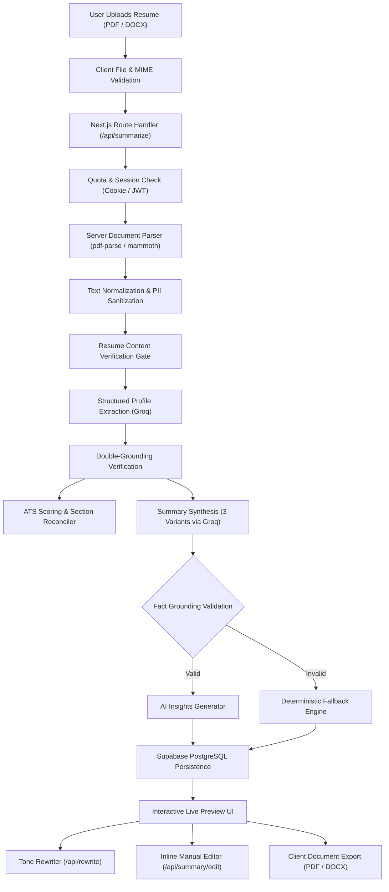

# Resumly

> AI-Powered Resume Analysis & Recruiter-Ready Summary Generator. Understand, evaluate, and elevate your candidate positioning in seconds.

[](https://resumly-eta.vercel.app/)
[](https://nextjs.org/)
[](https://react.dev/)
[](https://www.typescriptlang.org/)
[](https://tailwindcss.com/)
[](https://groq.com/)
[](https://supabase.com/)

---

### 🚀 Live Demo: **[https://resumly-eta.vercel.app/](https://resumly-eta.vercel.app/)**

---

## 1. Project Overview

**Resumly** is an AI-first web application engineered to solve the most critical phase of candidate screening: the first six seconds a recruiter spends glancing at a resume. 

Rather than serving as a full resume builder or generic template editor, Resumly focuses exclusively on **candidate positioning, professional summaries, and ATS alignment**. Job seekers upload an existing resume in PDF or DOCX format. Resumly strips sensitive personally identifiable information (PII), parses career milestones and technical competencies, computes an ATS Readiness Score (0–100), and synthesizes three targeted, recruiter-ready summaries tailored to different hiring contexts.

### Core Value Proposition
- **High-Velocity Analysis**: Generates comprehensive ATS insights and summaries in seconds powered by Groq LPU inference (`openai/gpt-oss-120b`).
- **Context-Specific Summaries**: Generates Professional, ATS-Optimized, and Executive variations from verified candidate facts.
- **Privacy by Architecture**: Redacts personal contact details (emails, phone numbers, street addresses) prior to LLM processing.
- **Anti-Hallucination Grounding**: Double-checks extracted facts and AI outputs against raw resume source text, using deterministic fallback mechanisms if claims cannot be verified.
- **Interactive Refinement**: Supports real-time tone transformations (Confident, Technical, Action-Oriented, Creative) and direct in-browser editing.
- **Publication-Ready Exports**: Generates styled PDF candidate profile sheets and Microsoft Word (`.docx`) files directly on the client.

---

## 2. Key Features

### 📄 Multi-Format Document Ingestion
- **Server-Side Document Parsing**: High-performance extraction supporting binary PDF (`pdf-parse`) and OpenXML DOCX (`mammoth`).
- **Upload Validation & Integrity Checks**: Enforces 10 MB file size limits, MIME type verification, and PDF magic-byte validation (`%PDF-`), rejecting legacy `.doc` or corrupt uploads with clear error messaging.
- **Heuristic Quality Gates**: Detects whether uploaded files represent actual resumes through keyword coverage heuristics, rejecting non-resume files or unreadable scanned images (< 100 characters).
- **PII Scrubbing**: Automatically redacts email addresses, telephone numbers, and street locations before dispatching content to the AI provider.

### 🤖 Multi-Variant Summary Generation
Resumly generates three distinct summary styles tailored to modern hiring channels:
1. **💼 Professional Summary**: A balanced, recruiter-ready narrative (2–4 sentences) highlighting career trajectory, core technical strengths, and quantifiable impact.
2. **🎯 ATS-Optimized Summary**: High-density keyword synthesis aligned with Applicant Tracking System indexing algorithms.
3. **⚡ Executive Summary**: High-level strategic pitch focusing on leadership scope, team stewardship, and business ROI.

### 🎭 AI Tone Rewriter & In-Browser Editor
- **Tone Adjustments**: Dynamically rewrites any summary variation into one of four styles using Groq JSON mode:
  - **Confident**: Assertive, leadership-focused phrasing.
  - **Technical**: Stack-dense, highlighting architectures, frameworks, and engineering methodologies.
  - **Action-Oriented**: Results-first sentences anchored by strong operational verbs.
  - **Creative**: Dynamic framing emphasizing innovation and problem-solving.
- **Live Inline Editor**: Allows direct manual modifications with real-time state synchronization and database persistence.
- **One-Click Clipboard**: Instant copy functionality for quick application submissions.

### 📊 ATS Readiness Scoring & Diagnostic Engine
- **Composite Score (0–100)**: Evaluates resumes across quantifiable metrics, section structure, and skill completeness.
- **Deduction Breakdown**: Outlines structural penalties with actionable fix recommendations.
- **Skill Extraction & Normalization**: Automatically extracts, categorizes, and normalizes frameworks, languages, cloud platforms, and tooling.
- **Profile Metadata**: Estimates total years of experience, categorizes seniority level, detects candidate industry, and calculates word count and estimated reading time.

### 📥 Client-Side Document Exporters
- **PDF Profile Sheet**: Publishes publication-grade single-page profile sheets generated client-side using `jspdf`.
- **Word Document (`.docx`)**: Generates structured Microsoft Word documents with typography and styling using `docx`.

### 🔐 Hybrid Guest Quotas & Authentication
- **Anonymous Sandbox Quota**: Allows up to 3 free resume analyses without signing up, tracked via secure HTTP-only cookies (`anonymous_id`).
- **Supabase Authentication**: Email/password authentication modal (Login/Signup) powered by Supabase Auth.
- **Seamless Session Claiming**: Automatically links unclaimed guest summaries to newly authenticated accounts via `/api/history/claim`.
- **History Drawer**: Slide-out drawer displaying up to 15 recent resume analyses with one-click reload.

### 🎨 Editorial SaaS Experience
- **Typography Scale**: Pairings of **Outfit** (headings), **DM Sans** (body & form elements), and **JetBrains Mono** (scores and numerical metrics).
- **Dark-First Theme**: Full dark-mode interface with OKLCH theme tokens and seamless theme switching via `next-themes`.
- **Micro-Interactions**: Smooth entrance and layout transitions powered by `framer-motion`.

---

## 3. Technology Stack

| Layer | Technology | Purpose |
| :--- | :--- | :--- |
| **Framework** | **[Next.js 16.2](https://nextjs.org/)** | App Router, React Server Components, Turbopack, and API Route Handlers |
| **Frontend Library** | **[React 19.2](https://react.dev/)** | Core UI rendering with modern React Compiler support |
| **Language** | **[TypeScript 5.0](https://www.typescriptlang.org/)** | Strict type safety across client stores, server routes, and parser pipelines |
| **Styling** | **[Tailwind CSS v4](https://tailwindcss.com/)** | Next-generation styling engine with OKLCH color variables |
| **Animations** | **[Framer Motion 12](https://www.framer.com/motion/)** | UI transitions, spring-physics modals, and interactive workflows |
| **State Management** | **[Zustand 5](https://github.com/pmndrs/zustand)** | Centralized client state for resume data, history drawer, and upload progress |
| **AI Inference** | **[Groq SDK](https://groq.com/)** | Ultra-low latency LLM inference using `openai/gpt-oss-120b` |
| **AI Abstraction** | **[OpenAI SDK](https://github.com/openai/openai-node)** | Secondary provider implementation satisfying the shared `AIProvider` contract |
| **Document Parsers** | **[pdf-parse](https://www.npmjs.com/package/pdf-parse)** & **[mammoth](https://www.npmjs.com/package/mammoth)** | Server-side binary PDF and OpenXML DOCX text extraction |
| **Document Exporters**| **[jsPDF](https://github.com/parallax/jsPDF)** & **[docx](https://docx.js.org/)** | Client-side dynamic PDF and Word document generators |
| **Database & Auth** | **[Supabase](https://supabase.com/)** | Managed PostgreSQL database, Supabase Auth (JWT), and Service Role administration |
| **Icons & Theme** | **[Lucide React](https://lucide.dev/)** & **[next-themes](https://github.com/pacocoursey/next-themes)** | Consistent iconography and system dark/light mode toggling |

---

## 4. Project Architecture

### Data Processing Pipeline



### Architectural Highlights
- **Decoupled AI Engine**: Providers implement a unified `AIProvider` interface (`generateSummary(systemMessage, userPrompt)`). The primary runtime uses Groq LPU inference for high throughput, while an OpenAI implementation is available without requiring UI alterations.
- **Double-Grounding Verification**: Extracted facts and generated summaries pass through rigorous entity and metric cross-referencing against the source text. If hallucinations occur, an automatic feedback retry loop activates; if validation fails again, a deterministic fallback builder executes.
- **Server-Side Service Role Isolation**: Client queries run securely under Row Level Security (RLS), while administrative tasks (guest session tracking, usage quota checks, and history claiming) execute via the server-side Supabase Service Role client (`getSupabaseAdmin()`).
- **Zero React-Context Performance**: Global client state is centralized in a single Zustand store (`src/store/summarization.ts`), isolating re-renders strictly to components displaying updated state.

---

## 5. Project Structure

```
Resumly/
├── .github/
│   └── workflows/
│       └── supabase-keepalive.yml   # 8-hour cron ping to maintain Supabase activity
├── public/                          # Static branding, favicons, and metadata icons
├── src/
│   ├── app/                         # Next.js App Router
│   │   ├── api/                     # Backend Route Handlers
│   │   │   ├── history/             # Session history retrieval
│   │   │   │   └── claim/           # Guest-to-user history migration endpoint
│   │   │   ├── newsletter/          # Preserved disabled endpoint (returns 404)
│   │   │   ├── rewrite/             # AI tone rewriting endpoint
│   │   │   ├── summarize/           # Resume analysis, parsing & extraction
│   │   │   │   └── usage/           # Guest quota and usage checking endpoint
│   │   │   └── summary/
│   │   │       └── edit/            # Inline manual summary editing endpoint
│   │   ├── privacy/                 # Privacy Policy page
│   │   ├── terms/                   # Terms of Service page
│   │   ├── globals.css              # Tailwind CSS v4 variables and token mapping
│   │   ├── layout.tsx               # Root layout, font definitions, theme provider
│   │   └── page.tsx                 # Main application landing page
│   ├── components/
│   │   ├── common/                  # Reusable UI primitives, cards, buttons, theme provider
│   │   ├── layout/                  # Navbar, Footer, AuthModal, HistorySidebar, AuthInitializer
│   │   └── ui/                      # Base button primitive
│   ├── features/
│   │   └── landing/                 # Landing modules & workflow visualizations
│   │       ├── components/          # Animated workflow diagram
│   │       └── sections/            # Hero, UploadSection, LivePreview, HowItWorks
│   ├── lib/
│   │   ├── ai/                      # Document parsers, cleaners, validators, Groq/OpenAI providers
│   │   │   ├── prompts/             # System prompt templates
│   │   │   └── providers/           # Groq and OpenAI SDK implementations
│   │   ├── summarization/           # Scoring engine, profile extractor, fact verifiers, test suite
│   │   ├── anonymousSession.ts      # HTTP-only guest session cookie management
│   │   ├── documentExporter.ts      # Client-side PDF and Word document generators
│   │   ├── quota.ts                 # Anonymous and authenticated quota enforcement
│   │   ├── supabase.ts              # Supabase browser client & server admin client
│   │   └── utils.ts                 # Class merging and formatting utilities
│   ├── mock/                        # Mock data for initial states and preview cards
│   ├── proxy.ts                     # In-memory IP rate limiter
│   ├── store/
│   │   └── summarization.ts         # Zustand store for app state & asynchronous actions
│   └── types/                       # TypeScript schemas and type definitions
├── .env.example                     # Environment template with placeholder values
├── components.json                  # shadcn/ui configuration
├── next.config.ts                   # Next.js configuration (Turbopack, React Compiler)
├── package.json                     # Project scripts and dependencies
├── tsconfig.json                    # TypeScript compiler configuration
└── README.md                        # Technical project documentation
```

---

## 6. Environment Configuration

Resumly uses Next.js environment resolution. Local configurations are defined in `.env` (or `.env.local`, both ignored by git), while `.env.example` provides a sanitized template.

### Configuration Reference

| Variable | Required | Scope | Default / Value | Description |
| :--- | :--- | :--- | :--- | :--- |
| `NEXT_PUBLIC_SUPABASE_URL` | **Yes** | Client & Server | — | Supabase project API URL |
| `NEXT_PUBLIC_SUPABASE_ANON_KEY` | **Yes** | Client & Server | — | Supabase public anonymous key (browser-safe) |
| `SUPABASE_SERVICE_ROLE_KEY` | **Yes** | Server Only | — | Supabase service role secret (bypasses RLS for admin operations) |
| `AI_PROVIDER` | No | Server Only | `groq` | Configured AI provider (`groq` or `openai`) |
| `GROQ_API_KEY` | **Yes** (if Groq) | Server Only | — | Groq Cloud API key for LPU inference |
| `GROQ_MODEL` | No | Server Only | `openai/gpt-oss-120b` | Groq model identifier |
| `OPENAI_API_KEY` | Optional | Server Only | — | OpenAI API key (used if using OpenAI provider) |
| `OPENAI_MODEL` | No | Server Only | `gpt-4o-mini` | OpenAI model identifier |
| `MAX_UPLOAD_SIZE` | No | Server Only | `10485760` (10 MB) | Maximum permitted upload file size in bytes |
| `MAX_RESUME_CHARACTERS` | No | Server Only | `25000` | Maximum character limit sent to AI prompts |
| `RATE_LIMIT_MAX` | No | Server Only | `0` (disabled) | Max requests allowed per IP window (`src/proxy.ts`) |
| `RATE_LIMIT_WINDOW_MS` | No | Server Only | `60000` (60s) | Sliding time window for rate limiting in ms |

---

## 7. API Overview

All backend endpoints are built as Next.js Route Handlers located under `src/app/api/`:

### `POST /api/summarize`
Coordinates resume ingestion, text parsing, PII redaction, ATS scoring, and summary generation.
- **Request**: `multipart/form-data` with `resume` file (`.pdf` or `.docx`), or `application/json` with `{ resumeText, fileName }`.
- **Headers**: Optional `Authorization: Bearer <token>` or `x-session-id: <uuid>`.
- **Response**: `200 OK` with `SummarizationSuccess` payload containing ATS score, deductions, profile facts, 3 summary variations, and remaining quota.

### `GET /api/summarize/usage`
Checks quota usage for guest sessions or verifies active user authentication.
- **Response**: `200 OK` with `{ authenticated: boolean, usage: { used, limit, remaining } | null }`.

### `POST /api/rewrite`
Rewrites an active summary variant into a target tone.
- **Request**: `application/json` with `{ id, text, variant, tone }` (`variant`: `professional` | `ats` | `executive`; `tone`: `confident` | `technical` | `action-oriented` | `creative`).
- **Response**: `200 OK` with `{ success: true, rewrittenText: string, usage: object }`.

### `POST /api/summary/edit`
Saves manual inline edits to a specific summary variant in the database.
- **Request**: `application/json` with `{ id, text, variant }`.
- **Response**: `200 OK` with `{ success: true, text: string }`.

### `GET /api/history`
Retrieves past resume analyses for the active session.
- **Parameters**: `?session_id=<id>` for guest users, or `Authorization: Bearer <token>` for authenticated users.
- **Response**: `200 OK` with list of past summary records sorted by `created_at DESC` (limit: 15).

### `POST /api/history/claim`
Migrates unclaimed guest summaries associated with a session ID to a newly authenticated user account.
- **Headers**: `Authorization: Bearer <token>`.
- **Response**: `200 OK` with `{ success: true, claimedCount: number }`.

### `POST /api/newsletter`
Route preserved with a `404 Not Found` response while newsletter features are temporarily inactive.

---

## 8. Database Overview

Resumly utilizes a managed PostgreSQL database hosted on **Supabase**.

### Table: `summaries`
Stores generated resume summaries, ATS metrics, and candidate profile facts:

| Column | Type | Nullable | Description |
| :--- | :--- | :--- | :--- |
| `id` | `UUID` | No | Primary Key (`gen_random_uuid()`) |
| `created_at` | `TIMESTAMPTZ` | No | Record creation timestamp (`now()`) |
| `user_id` | `UUID` | Yes | Foreign key referencing Supabase Auth `auth.users(id)` |
| `session_id` | `TEXT` | Yes | Anonymous session identifier for guest quota tracking |
| `file_name` | `TEXT` | No | Uploaded resume file name |
| `job_title` | `TEXT` | Yes | Inferred or extracted candidate job title |
| `score` | `INTEGER` | No | Calculated ATS Readiness Score (0–100) |
| `word_count` | `INTEGER` | Yes | Total word count of parsed resume text |
| `reading_time` | `TEXT` | Yes | Estimated reading time (e.g. `"2 min read"`) |
| `detected_experience`| `TEXT` | Yes | Detected seniority or years of experience |
| `detected_industry` | `TEXT` | Yes | Inferred professional industry classification |
| `skills` | `TEXT[]` | Yes | Extracted key competencies and technologies |
| `professional` | `TEXT` | Yes | Generated Professional Summary text |
| `ats` | `TEXT` | Yes | Generated ATS-Optimized Summary text |
| `executive` | `TEXT` | Yes | Generated Executive Summary text |
| `tips` | `TEXT[]` | Yes | Actionable improvement recommendations |

### Security & Automated Maintenance
- **Row Level Security (RLS)**: Client operations are scoped to the authenticated user ID.
- **Administrative Bypass**: Server-side Route Handlers execute administrative queries using `SUPABASE_SERVICE_ROLE_KEY`, ensuring guest session claiming and anonymous quota verification operate securely.
- **Automated Keep-Alive**: A scheduled GitHub Actions workflow (`.github/workflows/supabase-keepalive.yml`) queries the database every 8 hours to prevent free-tier project pausing.

---

## 9. Deployment Information

Resumly is optimized for continuous deployment on **Vercel**:
- **Application Platform**: Vercel (Next.js App Router serverless execution).
- **Production URL**: **[https://resumly-eta.vercel.app/](https://resumly-eta.vercel.app/)**
- **Continuous Integration**: Pushes to `main` automatically trigger production builds and deployments.
- **Required Production Secrets**: Configure `NEXT_PUBLIC_SUPABASE_URL`, `NEXT_PUBLIC_SUPABASE_ANON_KEY`, `SUPABASE_SERVICE_ROLE_KEY`, and `GROQ_API_KEY` in the Vercel project settings.

---

## 10. Author & Credits

**Sudhanshu Kumar**
- **Live Demo**: [resumly-eta.vercel.app](https://resumly-eta.vercel.app/)
- **GitHub**: [@sudhanshuukr](https://github.com/sudhanshuukr)
- **LinkedIn**: [Sudhanshu Kumar](https://www.linkedin.com/in/sudhanshuukr/)
- **X (Twitter)**: [@sudhanshuworks](https://x.com/sudhanshuworks)

---

<div align="center">
  <sub>Built with precision by <a href="https://github.com/sudhanshuukr">Sudhanshu Kumar</a>. Powered by Next.js, Groq LPU, and Supabase.</sub>
</div>
